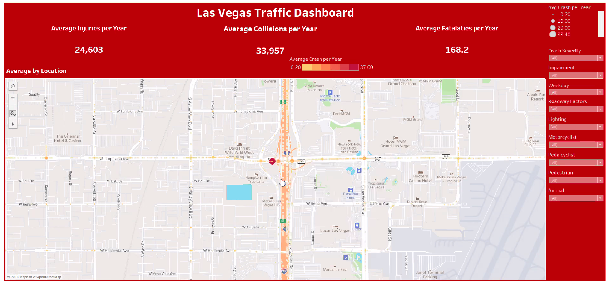
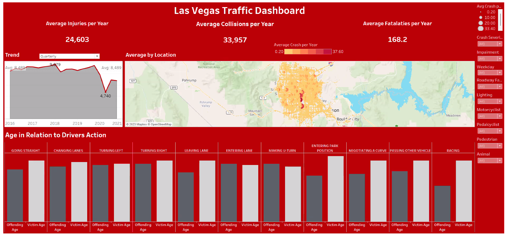

# Traffic Analysis & Crash Prediction (Las Vegas, NV)

---

## Project Overview
This project was completed as part of my hands-on work in data analytics and machine learning. Using real traffic crash data from Las Vegas and Clark County, Nevada, I walked through cleaning, storing, modeling, and visualizing data to answer key safety questions and build predictive models.

What differentiates this project from simple scripts is the **full analytical lifecycle**: from raw data through a database to modeled insight and dashboards.

---

## Learning Objectives
- Clean and prepare complex, real-world datasets
- Design and use a PostgreSQL database for structured analytics
- Train and evaluate machine learning models for classification
- Analyze feature importance to explain model behavior
- Build dashboards that communicate findings to stakeholders

---

## Data Preparation & Exploration

The source crash dataset came with thousands of records and dozens of fields. Early work focused on surveying and reshaping this data so it could be analyzed effectively:

- inspected column types and distributions
- handled missing and inconsistent values
- standardized date/time and categorical fields
- reduced noise by removing or reworking irrelevant fields

### Evidence – Data Preparation

I created an **Entity Relationship Diagram** (ERD) to plan how data would fit into PostgreSQL tables and relationships.

.png)

A snapshot of the **cleaned crash dataset**, ready for database import.

[Cleaned Traffic Data](Transformations/Nevada_traffic_cleanup.ipynb)

---

## Database Integration

Once the data was cleaned, I took it into PostgreSQL. This structure allowed for robust querying and ensured consistent results when connecting to Python and Tableau later.

Here are some highlights:

- used pgAdmin to create schemas and load tables
- wrote SQL queries to validate datasets
- connected Python to the database via `psycopg2`

---

## Machine Learning Model

With the database and clean data in place, I built classification models to find patterns and predict where crashes were most likely to occur. The focus was *interpretability and insight*, not just accuracy.

I tested models with different targets:
- **injury_type** (6 classes)
- **crash_severity** (3 classes)

The crash-severity target consistently produced more stable results.

### Evidence – Machine Learning

Confusion matrix from the **injury_type** model — showing performance breakdown.
[Confusion Matrix – Injury Type](machine_learning/MLM_injury_type.ipynb)

Confusion matrix from the **crash_severity** model — clearer separation and higher predictive value.
[Confusion Matrix – Crash Severity](machine_learning/MLM_injury_type.ipynb)

---

## Visualization & Dashboards

To communicate patterns and insights, I created Tableau dashboards that put data in context and showed geographic and temporal patterns.

### Evidence – Dashboards

This interactive map shows **crash frequency by location** in Las Vegas and surroundings.

Combined charts and filters help explore the patterns in time, severity, and contributing conditions.

---

## Tools & Skills Demonstrated

- **Python:** pandas, NumPy, scikit-learn  
- **Data Analysis & ETL:** data cleaning, feature selection  
- **Databases:** PostgreSQL, SQL querying  
- **Machine Learning:** classification models, evaluation metrics  
- **Visualization:** Tableau dashboards  
- **Workflow:** Jupyter Notebooks

---

## Challenges & Lessons Learned
- Real world datasets require much more cleanup than textbook examples.
- Choosing and engineering features is as important as choosing the model itself.
- Database structures make analysis clearer and repeatable.
- Visual storytelling is essential for communicating insights.
